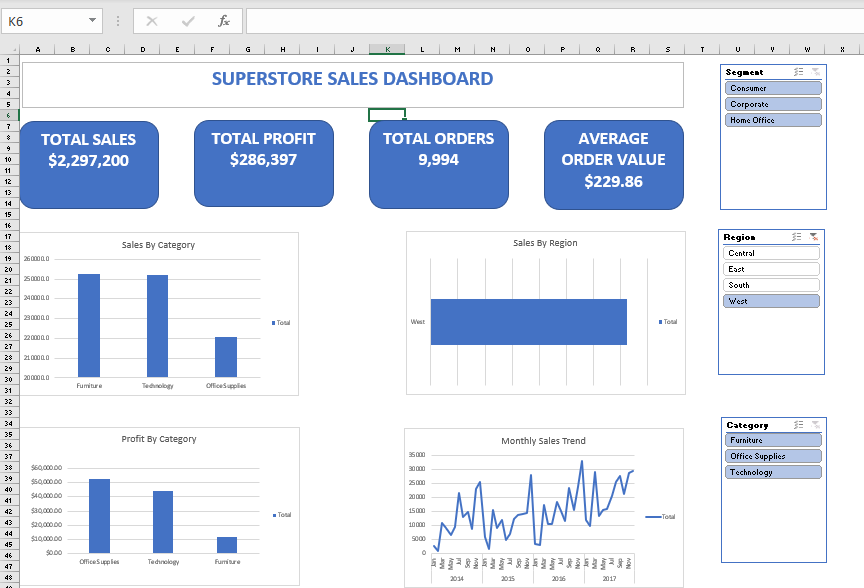

# Superstore Sales Dashboard

An interactive Excel dashboard that analyzes sales and profit for a retail superstore (2014-2017).

## Key numbers
- Total sales: $2,297,200
- Total profit: $286,397
- Total orders: 9,994
- Average order value: $229.86

## What I built
- Four KPI cards for sales, profit, orders, and average order value
- Charts for sales by category, profit by category, sales by region, and monthly sales trend
- Slicers for Segment, Region, and Category so the dashboard can be filtered interactively

## Findings
- Furniture and Technology bring in the most sales, but Furniture earns the least profit.
- Office Supplies has the lowest sales but the highest profit.
- Monthly sales move up and down through the year and trend upward from 2014 to 2017.

## Tools used
Microsoft Excel (pivot tables, pivot charts, slicers), data cleaning, data visualization

## Dataset
Superstore sales dataset (Kaggle)
